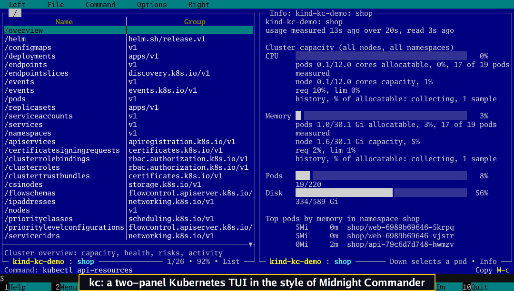
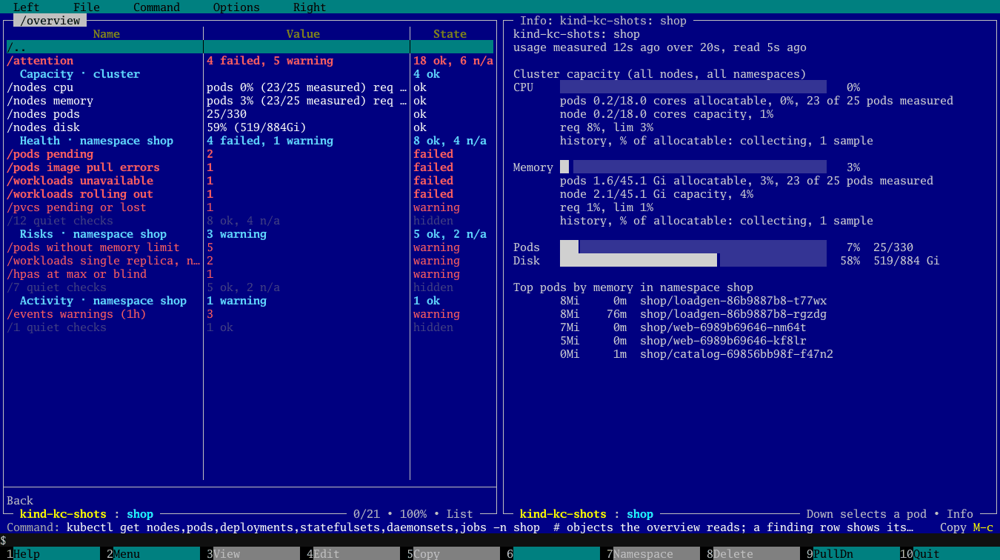
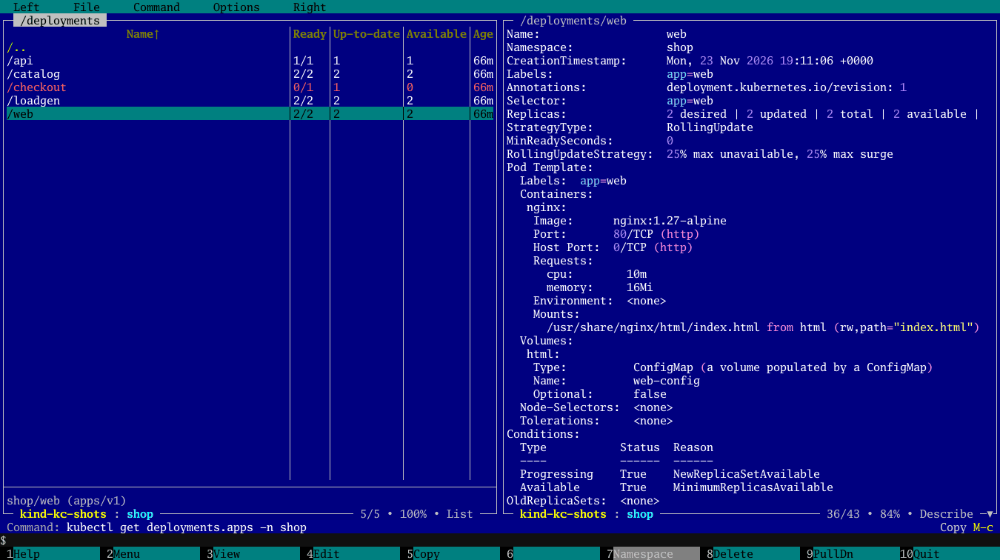

# Kubernetes Commander (kc)

[](https://github.com/stokaro/kc/actions/workflows/build.yml)



kc is a two-panel Kubernetes TUI in the style of Midnight Commander. You browse contexts, namespaces, resource types and objects like folders and files, and the lists stay live through controller-runtime informers. The second panel shows what the first one points at: its YAML, Describe, logs, or CPU and memory use. Or it browses a context of its own, so staging and prod sit side by side. Every change to the cluster asks first, in a dialog that names the context.

kc started as a fork of [Kubernetes Commander by Stefan Schimanski](https://github.com/sttts/kc) and is developed independently; report issues [here](https://github.com/stokaro/kc/issues), not upstream. See [NOTICE](NOTICE).

## Screenshots

The dashboard (`C-x g`) of a namespace. In iTerm2 3.7+, kitty and Ghostty kc draws the charts as images, as here; other terminals get the same charts in text:


The cluster overview (`M-i`) with the cluster capacity in the Info panel:



A Deployment list next to the Describe of the selected Deployment:



More in the [screenshot catalog](screenshots/README.md).

## Install

```bash
brew install --cask stokaro/kc/kc
```

Or `go install github.com/stokaro/kc/cmd/kc@latest` (Go 1.27 or later), or an archive for Linux or macOS from the [releases](https://github.com/stokaro/kc/releases). [Installing kc](docs/install.md) covers the checksums, the macOS quarantine attribute and building from source.

## Quick start

```bash
kc                     # the current context of your kubeconfig
kc -n shop get pods    # start in the pods of namespace shop
kc dashboard           # the full-screen dashboard of the namespace
kc --readonly          # refuse every change to the cluster
```

kc reads your kubeconfig and never changes it. On a cluster that matters, start with `--readonly`, or set read-only contexts in the [configuration](docs/configuration.md).

| Key | Action |
|---|---|
| `Enter` | Open the folder or object under the cursor |
| `Tab` | Switch between the panels |
| `C-s` | Quick search: type the start of a name |
| `F3` / `F4` | View / edit the object (`kubectl edit`) |
| `F8` | Delete, after a confirmation that names the context |
| `Insert` | Mark rows for an action on several objects |
| `C-1` / `C-2` | Switch the left / right panel between List, Describe, Manifest, Logs and Info |
| `M-i` | Cluster overview: what needs attention |
| `C-x g` | Dashboard of the scope, node, workload or pod under the cursor |
| `C-o` | The terminal under the panels |
| `F9` | Menu bar |
| `F1` | Help for what has focus |
| `F10` | Quit |

`F1` opens the help page of the dialog, panel mode or row in focus. The pages ship inside the binary; they are also readable [here](internal/help/topics/index.md).

## Documentation

- [Features](docs/features.md): what kc does, with links to the help pages.
- [Key bindings](docs/keys.md): every key of the panels and viewers.
- [Command line](docs/cli.md): `kc get`, `kc logs`, `kc overview`, `kc dashboard` and the scope flags.
- [Configuration](docs/configuration.md): `~/.kc/config.yaml`, custom columns, custom resource health, panel colors. [`config-default.yaml`](config-default.yaml) lists every setting with its default.
- [Custom commands](docs/commands.md): your own commands in the `F2` menu.
- [Installing kc](docs/install.md).

## Contributing

See [CONTRIBUTING.md](CONTRIBUTING.md) and [AGENTS.md](AGENTS.md) for the build and test commands and the conventions. kc is licensed under the [Apache License 2.0](LICENSE).
