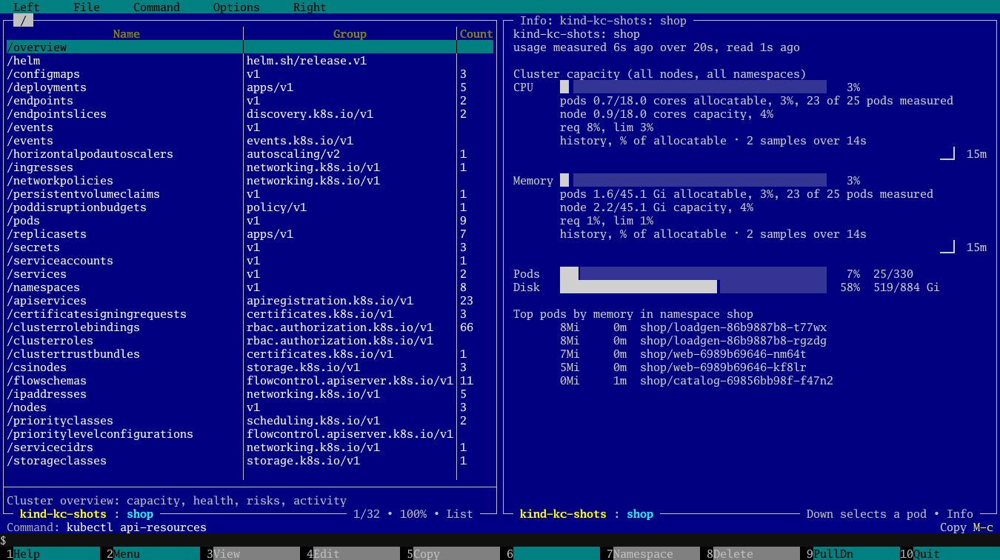

# Screenshots

Screenshots of kc's features, one page per topic, grouped as the [help index](../internal/help/topics/index.md) groups them. Every image comes from [`capture.sh`](capture.sh), which runs kc against a throwaway kind cluster seeded with [`docs/demo/seed.yaml`](../docs/demo/seed.yaml) and [`seed.yaml`](seed.yaml), so the objects and the problems on screen are the same each time. kc runs at 150x42 in UTC, with `charts.graphics: kitty`: the dashboard charts are the images that iTerm2 3.7, kitty and Ghostty show, which the capture driver draws into the PNGs.



## Topics

Each page has one line per image: what it shows and which keys lead there. `C-x w` means Ctrl+X, then W; `M-` is Alt.

- [Panels and navigation](panels/README.md): Contexts, namespaces, object lists, filters, marks, related objects, the hotlist, history and Helm releases.
- [Viewers and editing](viewer/README.md): The YAML, Describe, Manifest and Logs views, merged JSON logs with filters, local files, F4 and the copy dialog.
- [Info and the cluster overview](info/README.md): Info mode for workloads and nodes, the cluster overview and its findings.
- [Dashboard](dashboard/README.md): The full-screen CPU and memory dashboard (C-x g) of a namespace, a workload and a pod.
- [Investigation window](investigation/README.md): One time window for the Logs and Info panels and the dashboard (C-x w).
- [Diagnosis](diagnosis/README.md): /diagnosis of broken workloads, Services, claims, pending and crash-looping pods.
- [Rollout, Events and timeline](rollout/README.md): /rollout revisions, Events, the /timeline recorder and the Scale dialog.
- [NetworkPolicy between pods](networkpolicy/README.md): Whether one pod may reach another, and the policies that decide it (C-x n).
- [Node drain](drain/README.md): Node actions: drain options, the confirmation, progress and the cordoned node.
- [Comparing](compare/README.md): Comparing two objects, a local manifest with the live object, two lists, and another context.
- [Metric sources](metrics/README.md): Metric sources and the Prometheus backend (C-x m).
- [Menus, dialogs and help](menus/README.md): The menu bar, the user menu, panel options, confirm dialogs and the F1 help.
- [Terminal](terminal/README.md): The integrated terminal, the shell line and a shell in a container.

## How to regenerate

`capture.sh` creates a kind cluster named `kc-shots` with two workers, seeds it, captures every scene and deletes the cluster:

```bash
screenshots/capture.sh all
```

It needs what [`docs/demo/record.sh`](../docs/demo/README.md) needs: Go, Docker and kind (here or on a Linux host over ssh), kubectl, Helm and ffmpeg. ffmpeg cuts every PNG to 128 colors, which keeps the folder small. kc and kubectl run with a temporary `HOME` and a kubeconfig that holds only the kind cluster, and every kubectl call first checks the context and the server, so your own clusters are never touched.

The steps also run one by one, which is quicker when you change a scene:

```bash
screenshots/capture.sh up
screenshots/capture.sh seed
screenshots/capture.sh list                      # scenes in capture order
screenshots/capture.sh capture drain             # one group
screenshots/capture.sh capture panels/pods       # one scene
screenshots/capture.sh down
```

The cluster name, the API server port, an ssh host for Docker and the dashboard wait are set through `KC_SHOTS_*` variables; the header of `capture.sh` lists them. Run kind elsewhere with, for example, `KC_SHOTS_SSH=user@docker-host`.

The scenes are shell functions in [`scenes/`](scenes), one file per group. A function `scene_<group>_<name>` becomes `<group>/NN-<name>.png`, numbered in the order of the file. A scene that continues another one calls `after <group>/<name>`. The dashboard scenes collect samples first: five minutes for the namespace and half of that for each drilldown. Each of them waits until the screen shows the chart images, sent at the cell size of the PNG, and fails when they do not come; `screenshots/capture.sh capture dashboard` captures the group again after a change to the charts. The drain scenes cordon and uncordon `kc-shots-worker2`, and the timeline scenes scale `shop/web` and set it back, so a capture can run again on the same cluster.
