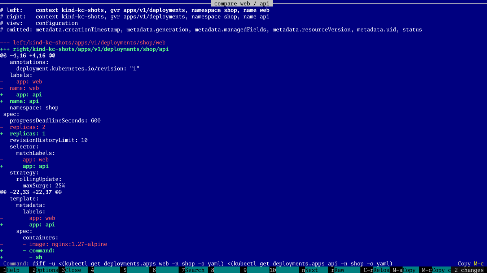
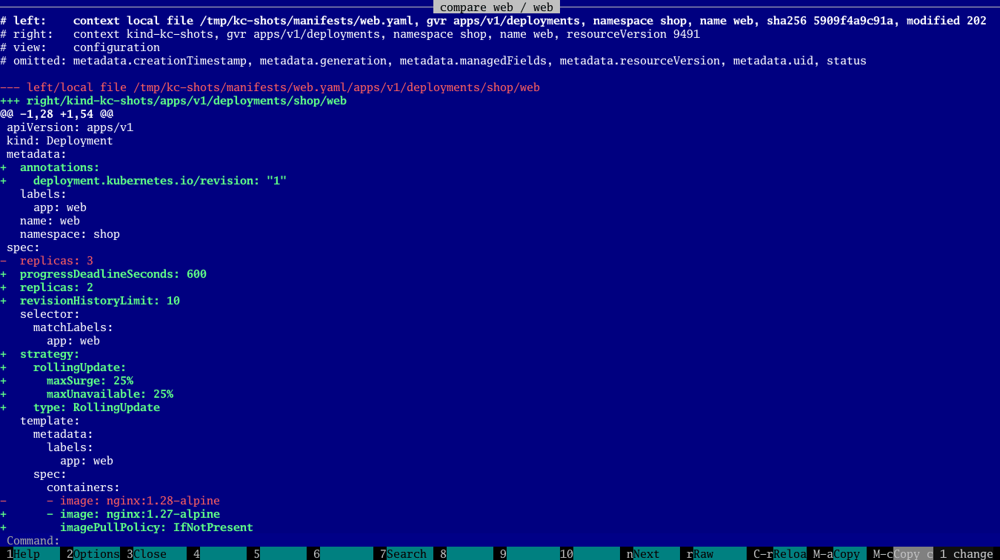
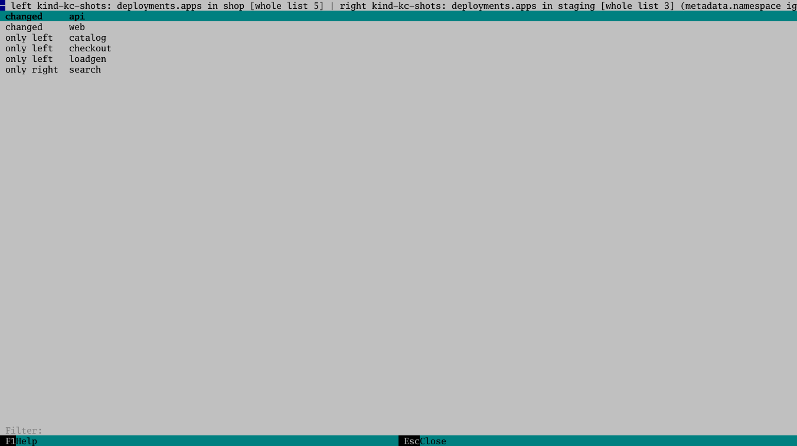
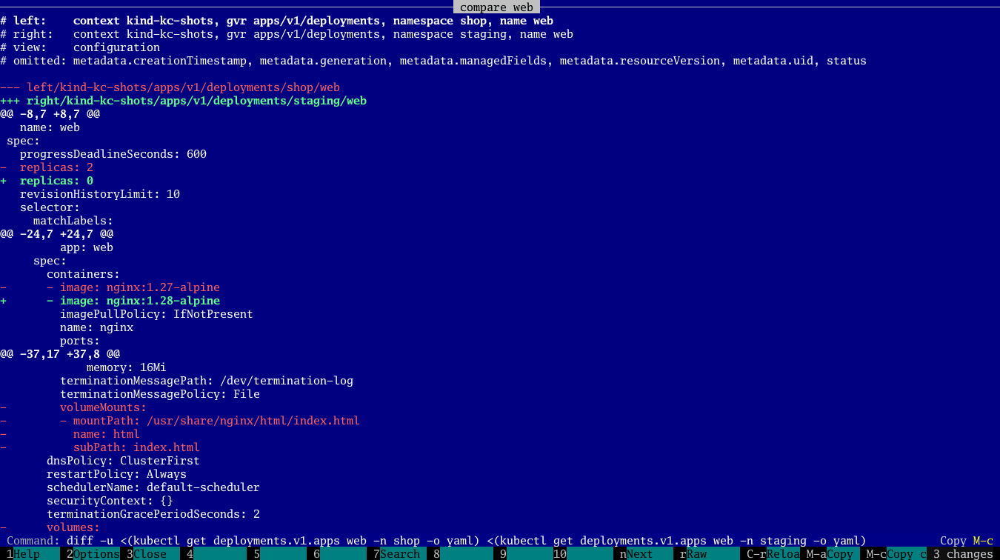
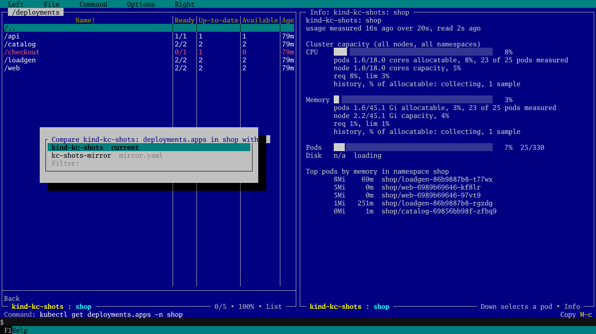
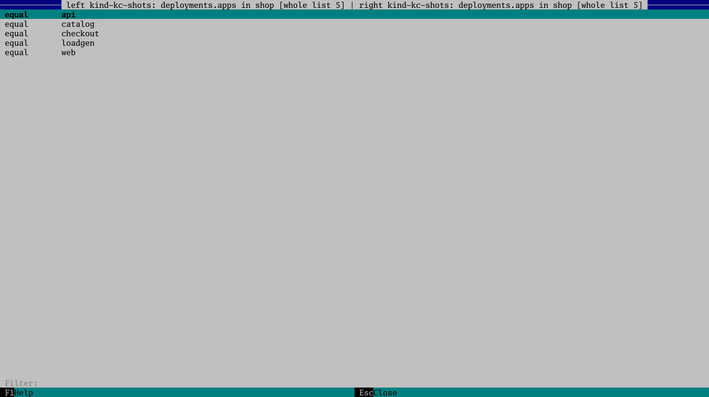

# Comparing

[All screenshots](../README.md)

Two objects, one in each panel. `C-x C-d`.

A local manifest against the live object. Local file in one panel, the object in the other, `C-x C-d`.

Two lists: Deployments in `shop` against `staging`. `C-x d`.

One pair of the list compare. Enter on a row.

Comparing a list with another context: the context picker. `C-x c`.

The result against the second context (which points at the same cluster here).

