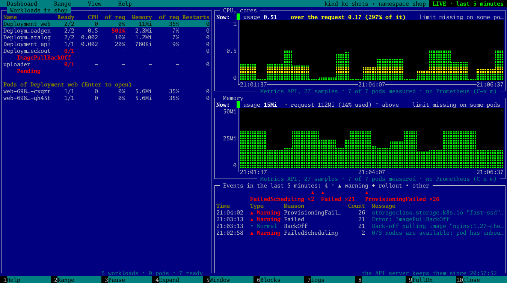
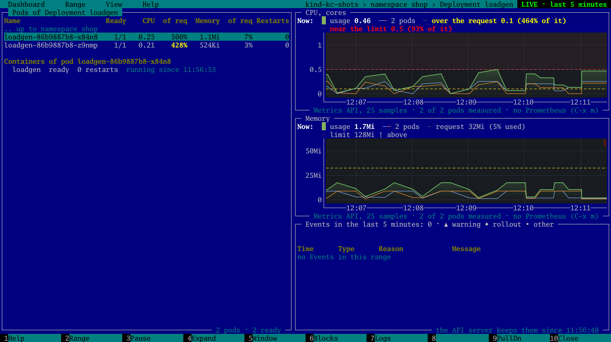
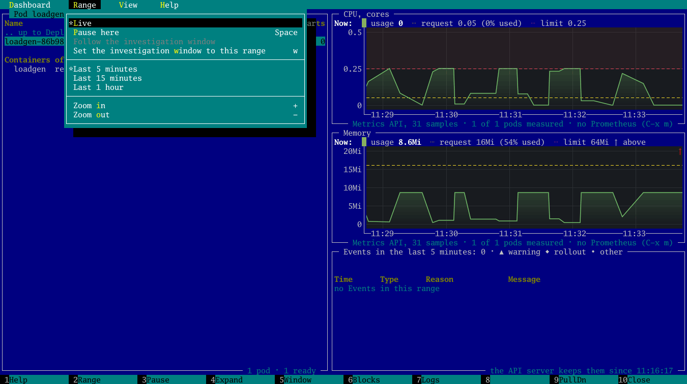
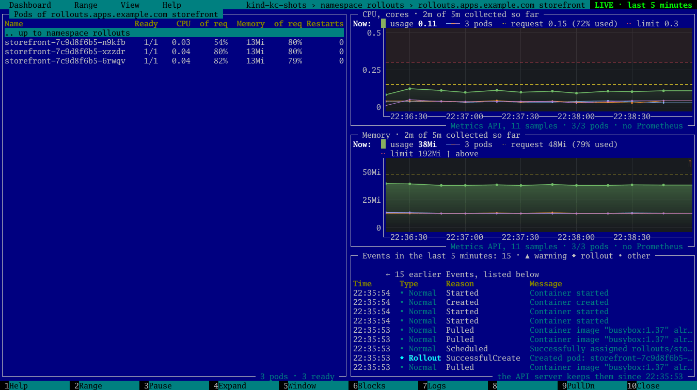

# Dashboard

[All screenshots](../README.md)

The charts are Kitty graphics images, as iTerm2 3.7, kitty and Ghostty show them. Other terminals, and `charts.graphics: text`, show them as blocks or braille; `F6` switches between images, blocks and braille.

The dashboard of the namespace: its workloads with their usage, share of the request and problems, the pods of the selected workload, CPU and memory over the session with the request and limit lines, and the Events of the range. `C-x g` at the root of a namespace; `+` zooms to the last 5 minutes.

A drilldown to one workload: its pods in the list, the charts and Events of the Deployment. `Up`/`Down` to the workload, `Enter`; `Backspace` goes up again.

The cursor on the CPU chart pauses the live view and shows the values and Events of that cell. `Tab` to the chart, then `Left`.

The focused chart on the whole screen. `F4`; `F4` again restores the layout.

The dashboard of one pod of the workload. `Space` to go live, `Shift+Tab` to the list, a pod row, `Enter`.

The Range menu. `F2`.

The dashboard of a custom workload, the Rollout of the Info screenshot. `C-x g` with the cursor on it; `+` zooms to the last 5 minutes.

