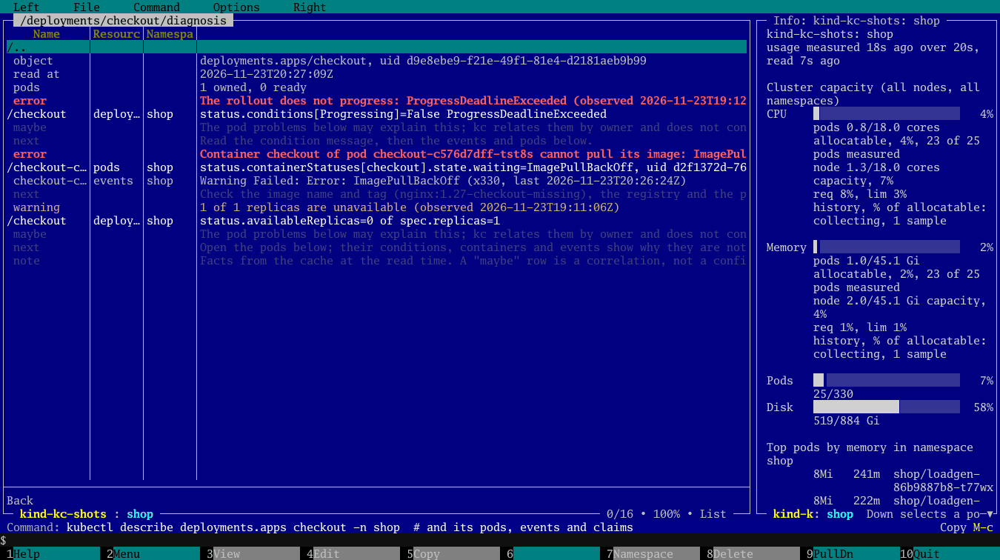
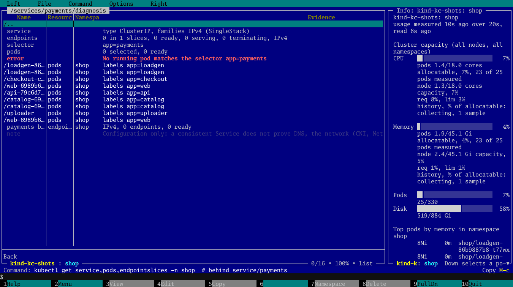
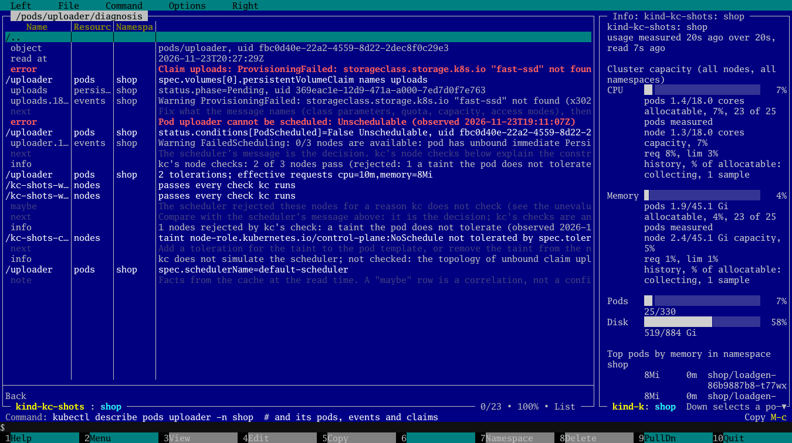
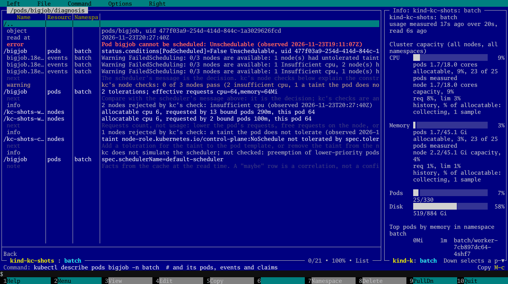
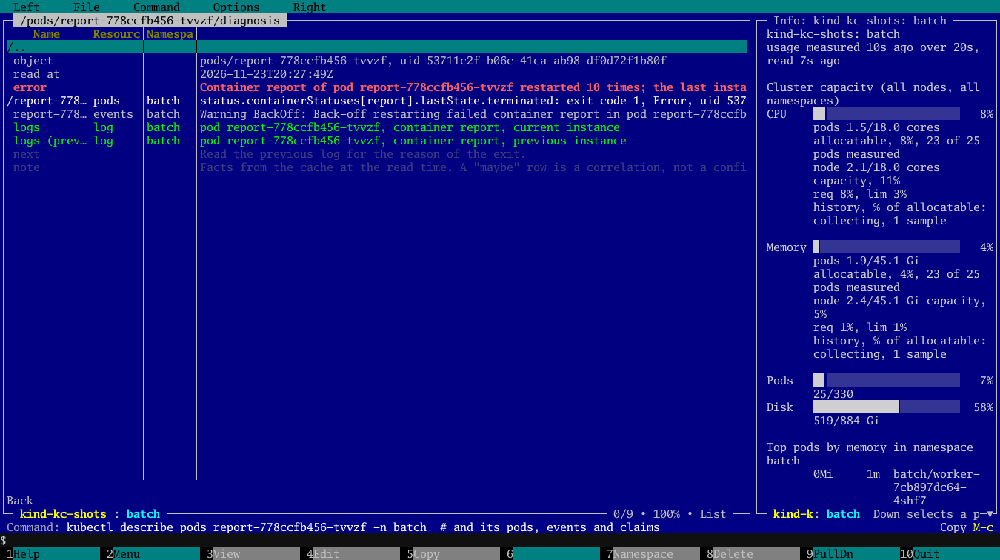

# Diagnosis

[All screenshots](../README.md)

`/diagnosis` of a Deployment whose pod cannot pull its image: the findings with their evidence and the next step. Enter `/diagnosis` inside a Deployment.

`/diagnosis` of a Service whose selector matches no running pod.

`/diagnosis` of a pod whose claim names a StorageClass that does not exist.

`/diagnosis` of a pod no node can take: the scheduler's message and kc's node checks.

`/diagnosis` of a crash-looping pod, with rows for the current and the previous log.

