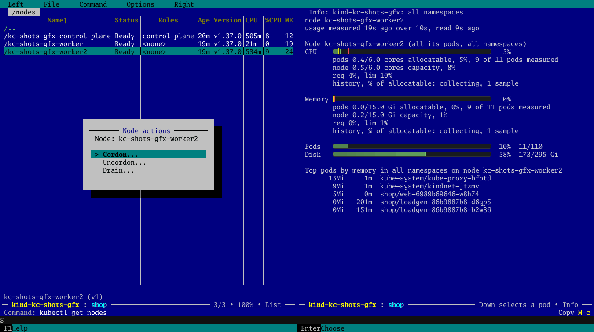
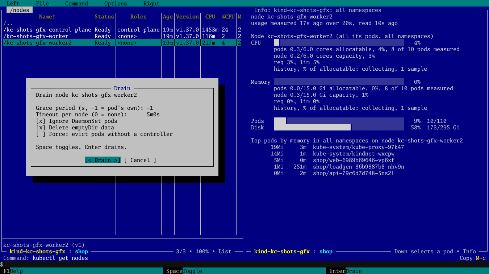
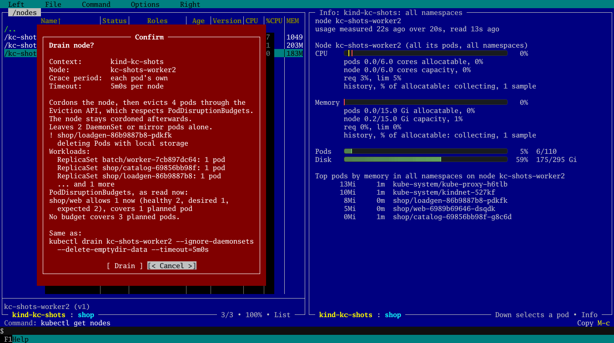
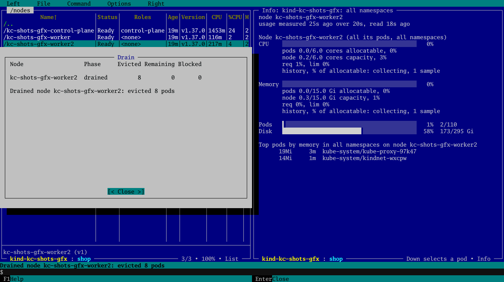
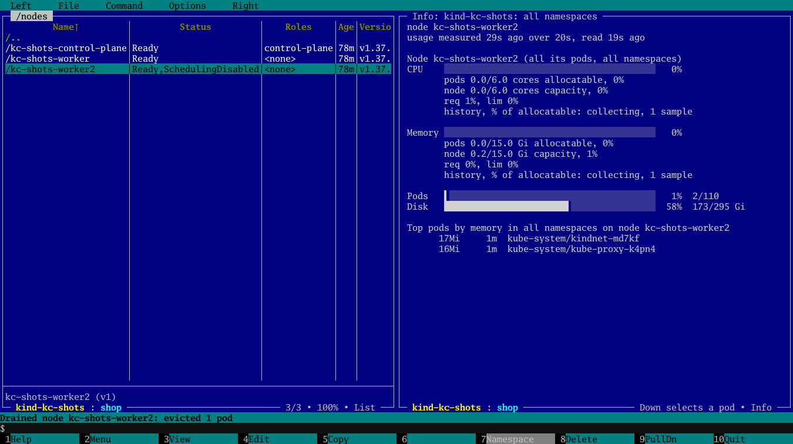

# Node drain

[All screenshots](../README.md)

The node actions. `M-n` on a node.

The drain options, with emptyDir data allowed for a pod that keeps data in one. Drain...

The confirmation: the context, what the drain evicts, the PodDisruptionBudgets and the same `kubectl drain` command. Enter.

The drain progress once it is done.

The node stays cordoned afterwards.

