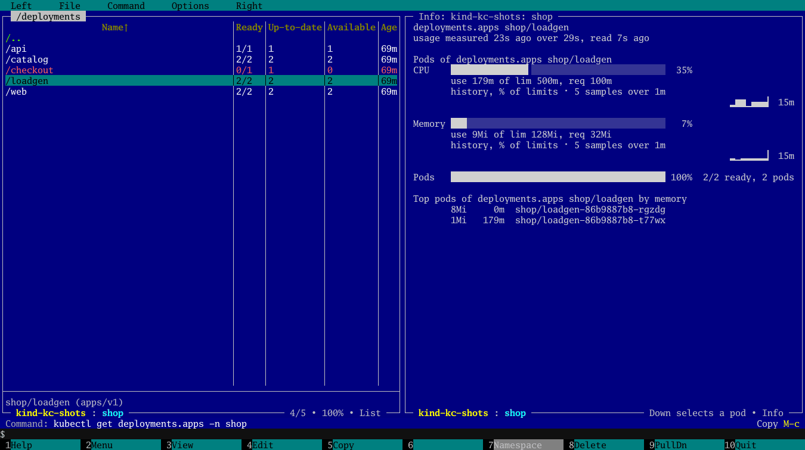
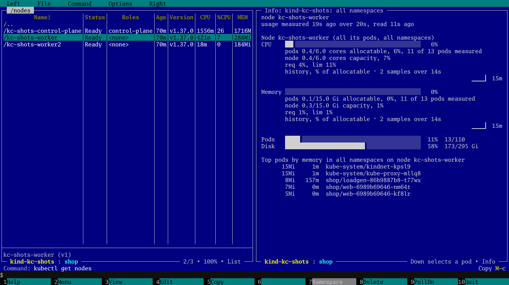
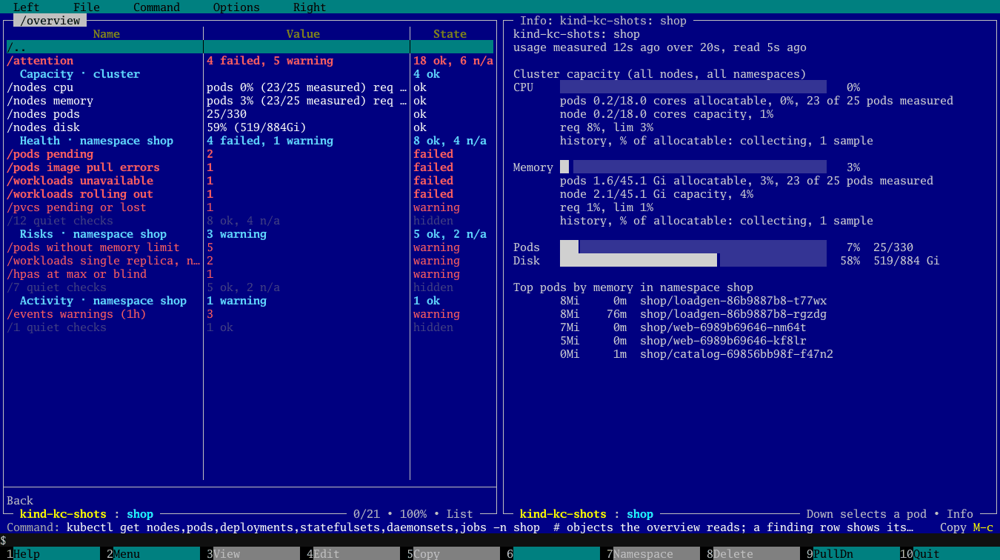
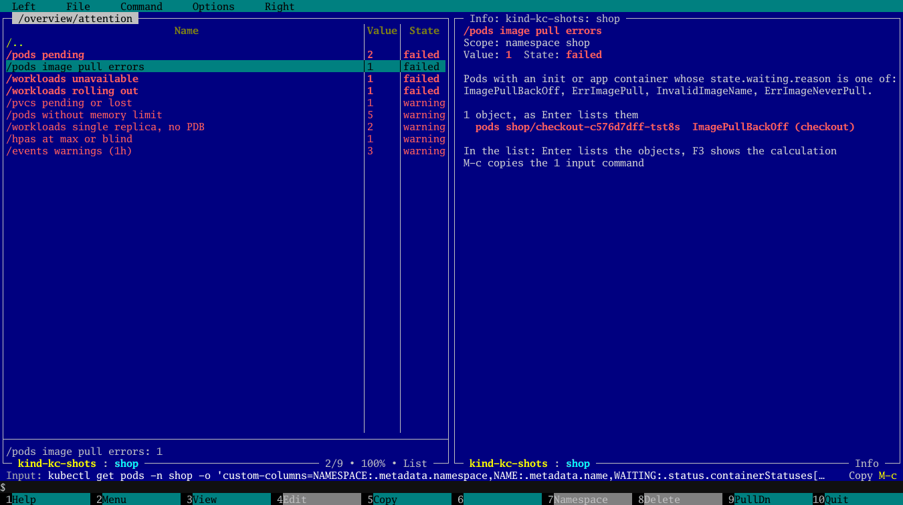
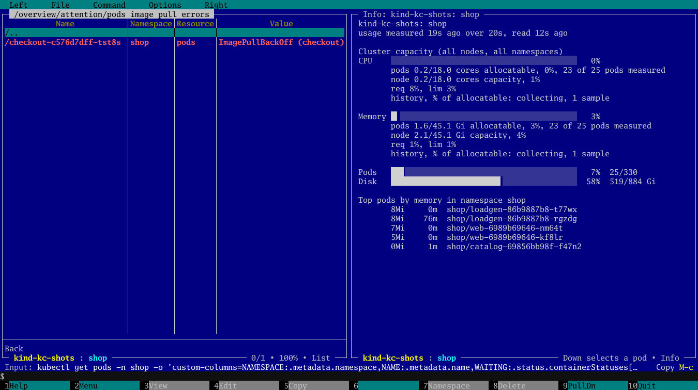

# Info and the cluster overview

[All screenshots](../README.md)

Info of a Deployment: CPU and memory of its pods against requests and limits, with a history and the top pods. Info mode in the other panel (`F9`, Right, Info), cursor on a Deployment.

Info of a node: allocatable and capacity, pods, disk and the top pods on it. Cursor on a node in `/nodes`.

The cluster overview: capacity, health, risks and activity checks with their state. `M-i`, or Enter on `/overview`.

`/attention`: only the failed and warning checks. Enter on `/attention`.

The objects behind one finding. Enter on a finding row.

