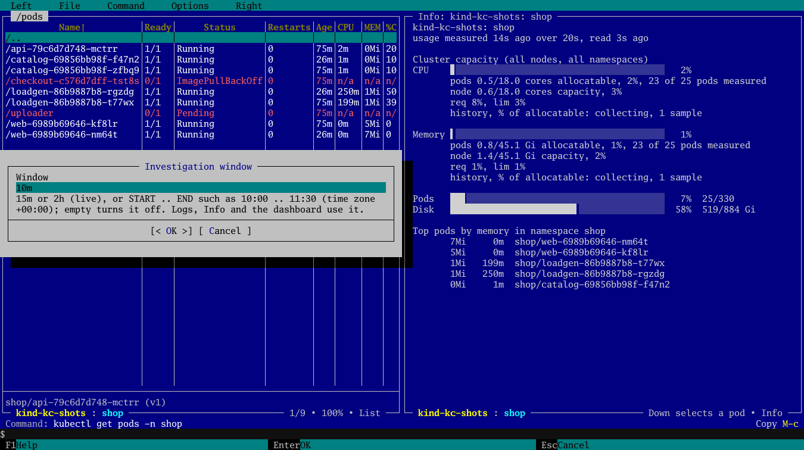
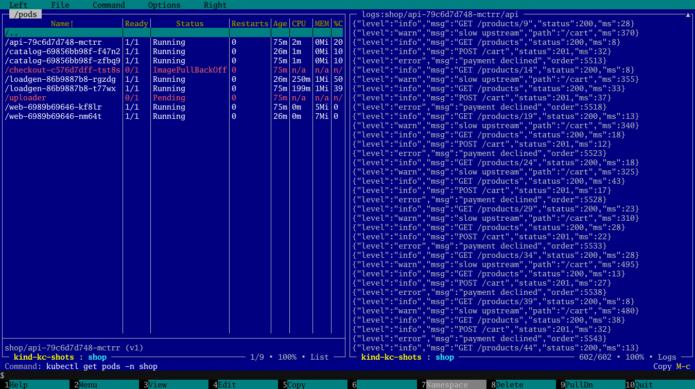
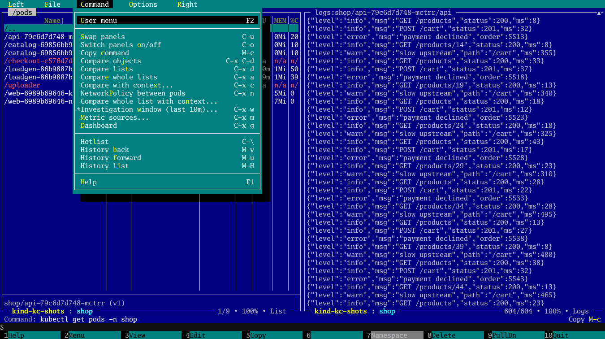

# Investigation window

[All screenshots](../README.md)

The investigation window dialog: one time window for the Logs and Info panels and the dashboard. `C-x w`, here with `10m`.

A Logs panel limited to the window.

The Command menu marks the active window. `F9`, Command.

