# Menus, dialogs and help

[All screenshots](../README.md)

The Left menu. `F9`.

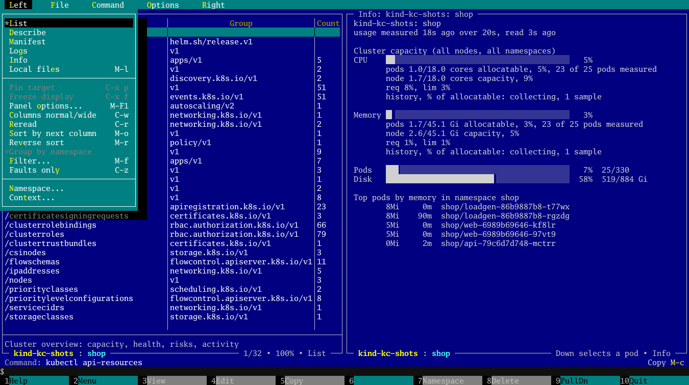

The File menu.

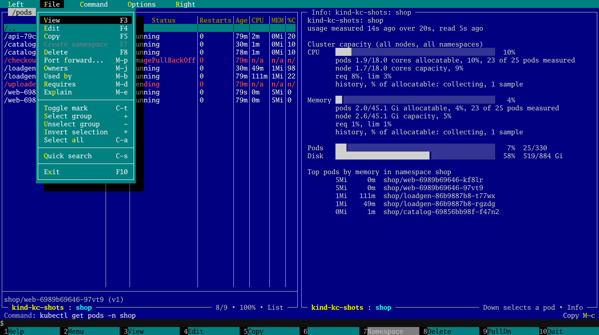

The Command menu.

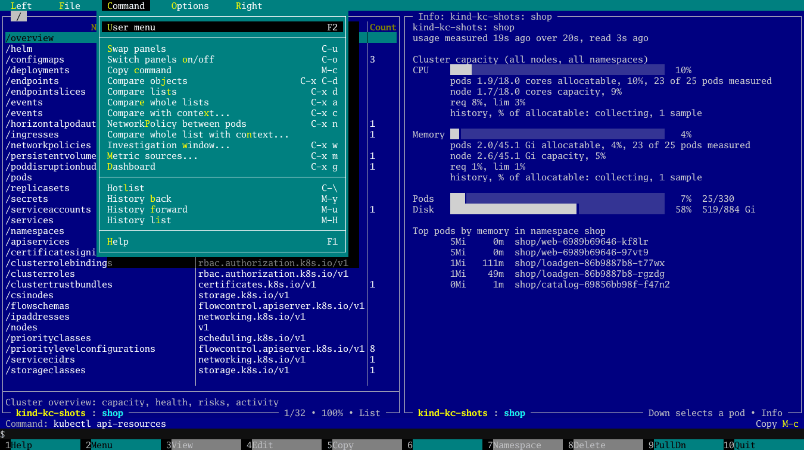

The Options menu.

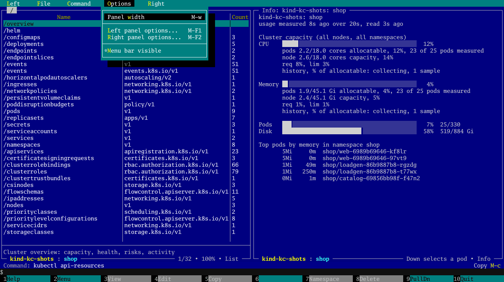

The user menu from the configuration. `F2`.

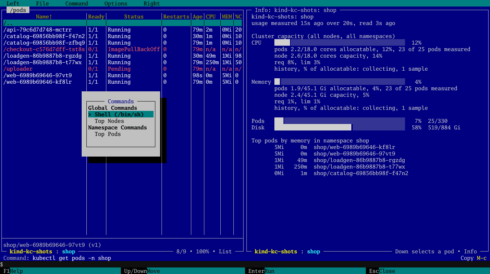

The panel options. `M-F1`, or `F9`, Options, Left panel options.

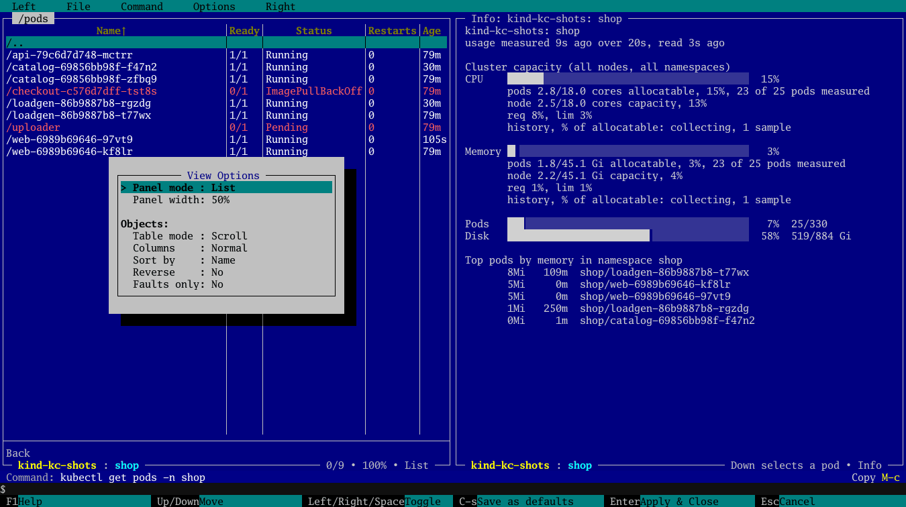

The delete confirmation. `F8`.

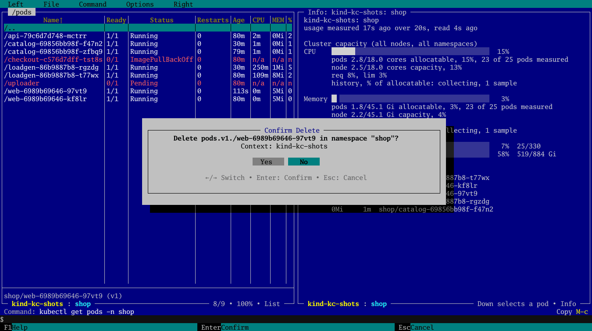

The create namespace dialog. `F7` in `/namespaces`.

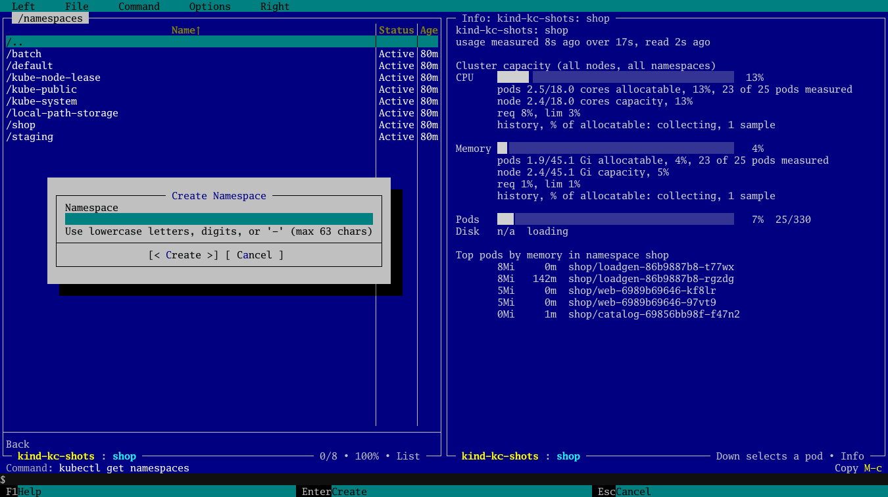

`F1` on a row opens the help page for it, here `/diagnosis`.

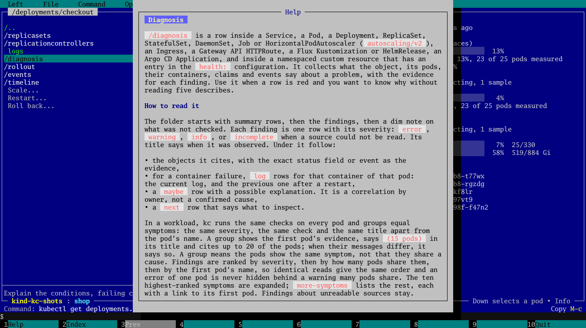

The help index. `F2` in the help.

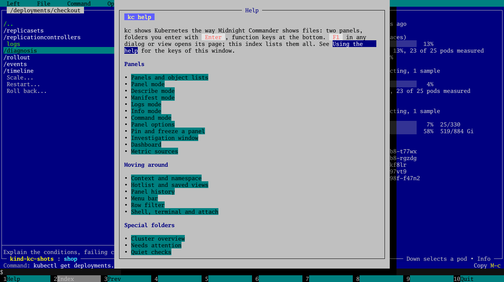

`F1` in a dialog opens its page, here the investigation window.

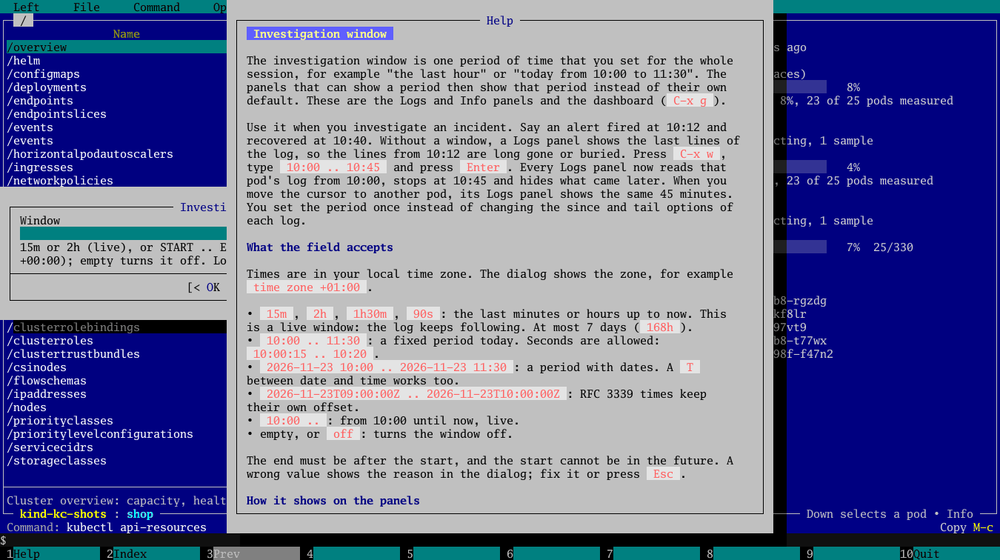
