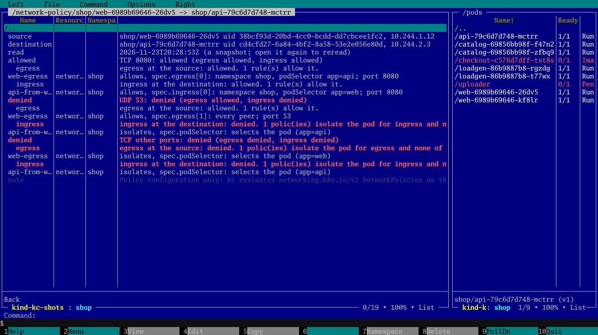
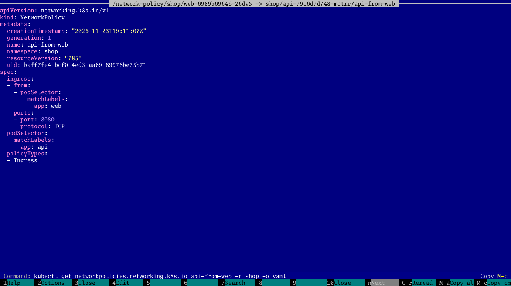

# NetworkPolicy between pods

[All screenshots](../README.md)

Whether a web pod (left panel) may reach an api pod (right panel), per port and direction, with the policies that decide it. `C-x n`.

One of the policies the result cites. `F3` on a policy row.

