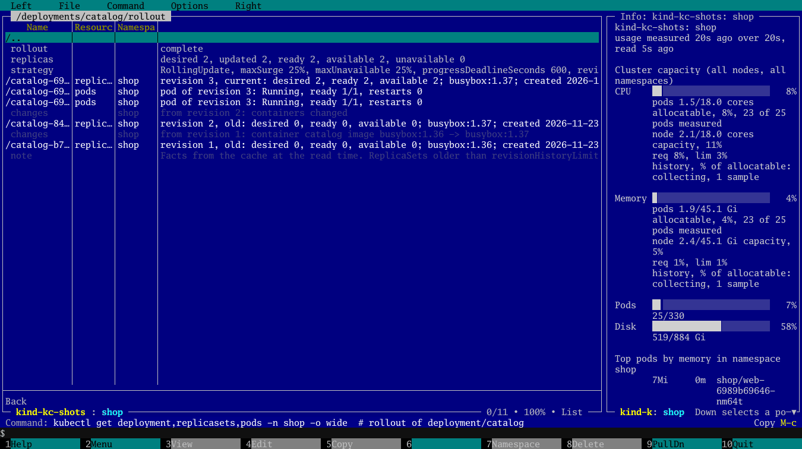
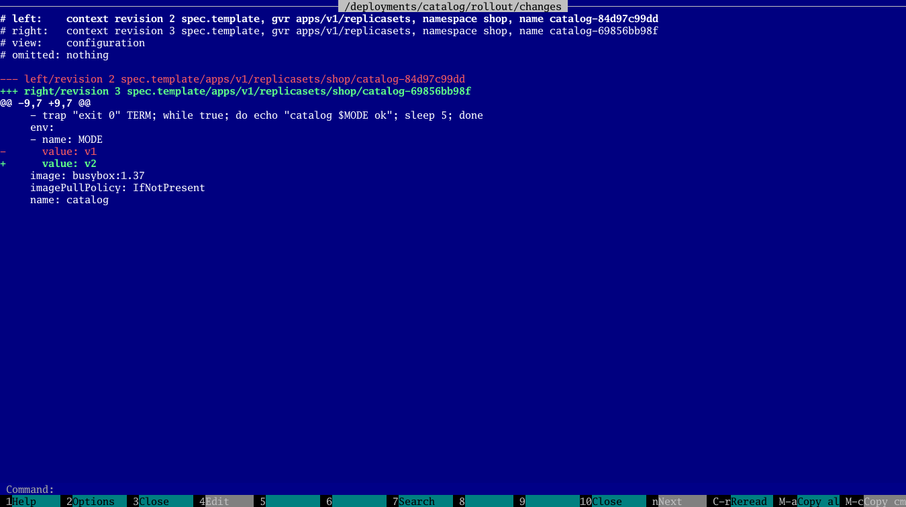
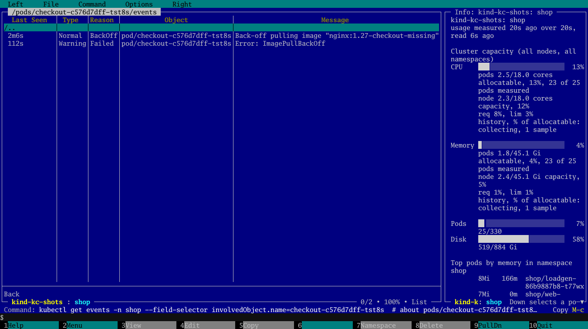
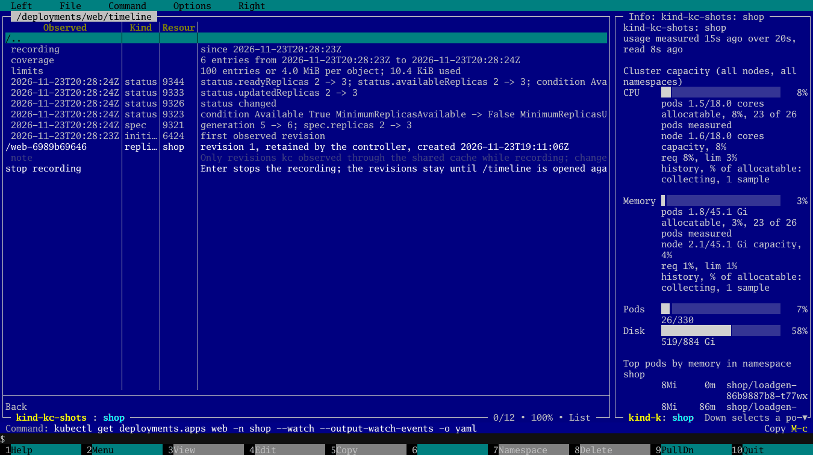
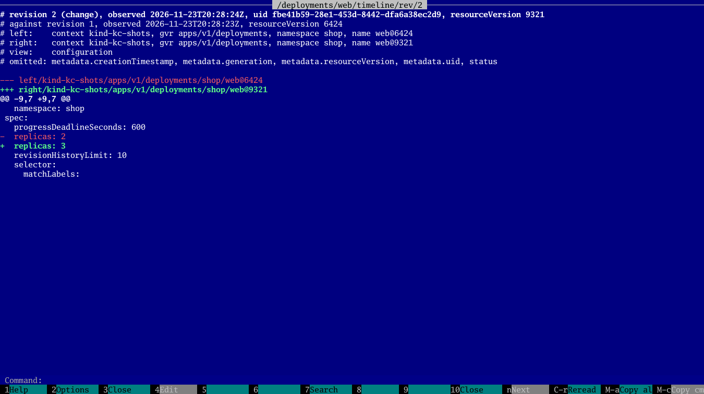
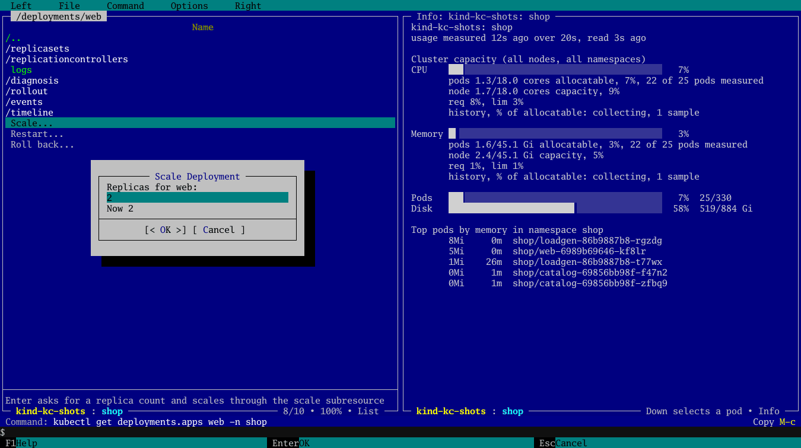

# Rollout, Events and timeline

[All screenshots](../README.md)

`/rollout` of a Deployment with three revisions and what changed between them. Enter `/rollout` inside a Deployment.

The pod template diff between two revisions. `F3` on a `changes` row.

`/events` of a pod.

`/timeline` of a Deployment: the changes kc observed while it records, here a scale from 2 to 3 replicas.

The diff of one timeline entry. `F3` on an entry.

The Scale dialog. Enter on `Scale...` inside a Deployment.

