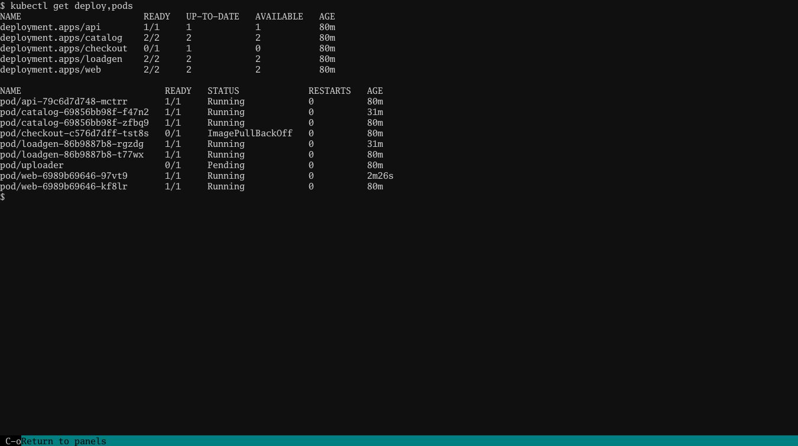
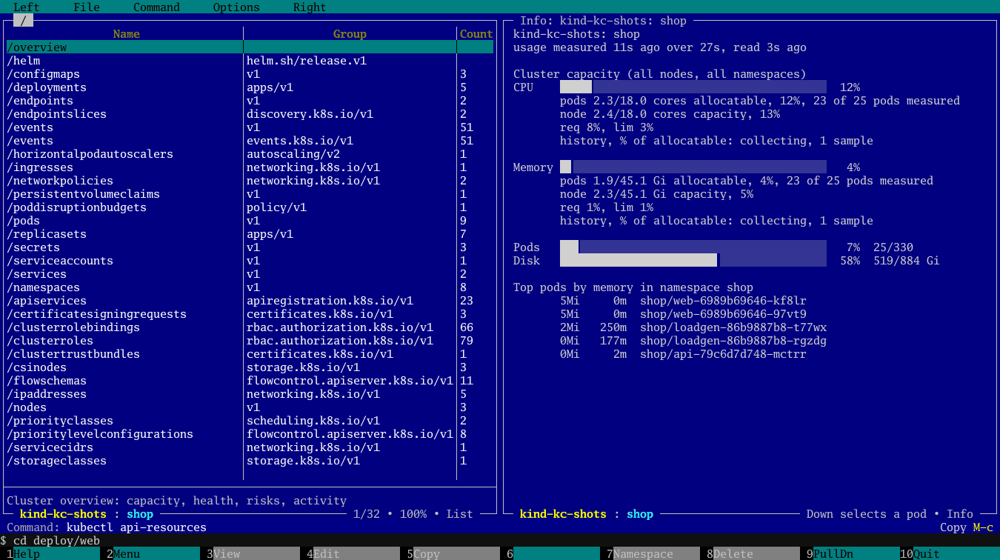
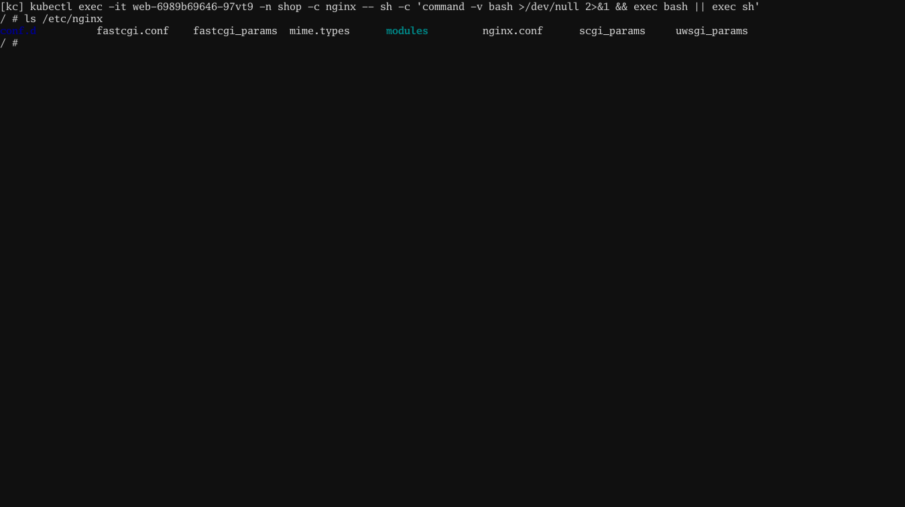

# Terminal

[All screenshots](../README.md)

The integrated terminal. `C-o`; `C-o` again returns to the panels.

The shell line under the panels: `cd` and kubectl-style commands. Type at the panels.

A shell in a container. `M-x` on a pod.

