# Viewers and editing

[All screenshots](../README.md)

The YAML viewer. `F3` on an object.

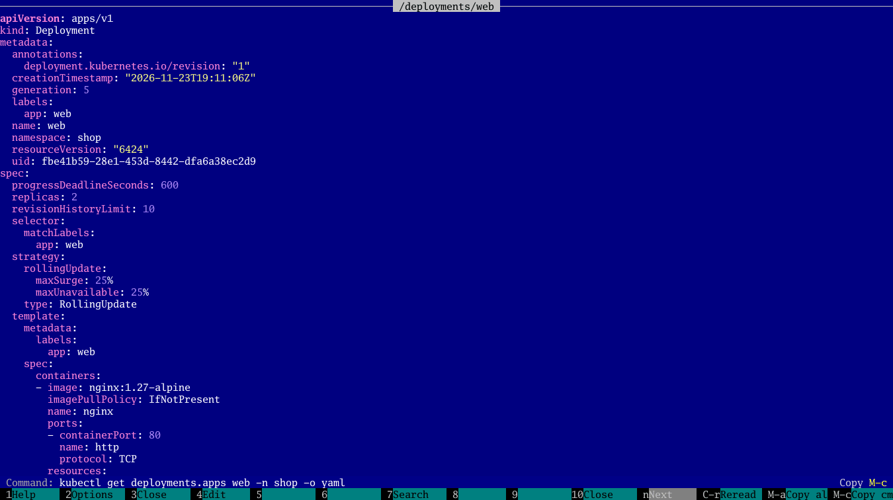

Search in the viewer. `F7` in a viewer.

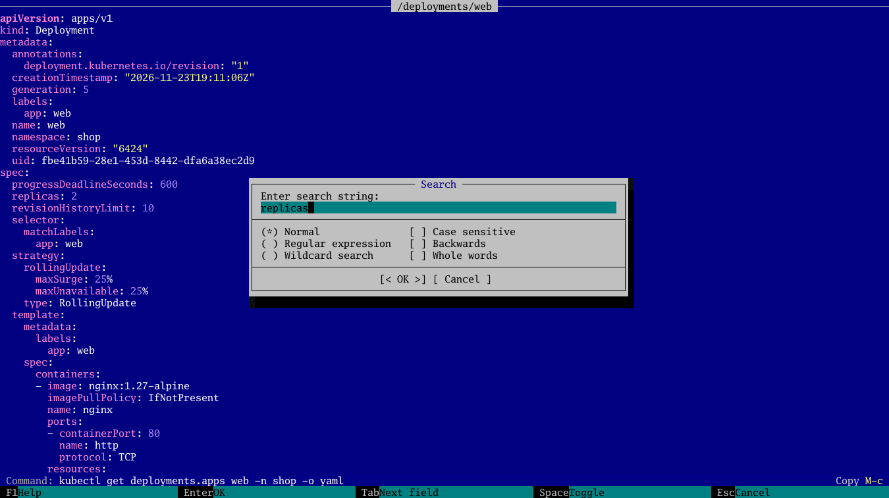

The Describe panel mode: the other panel describes the object under the cursor. `F9`, Right, Describe (`d`).

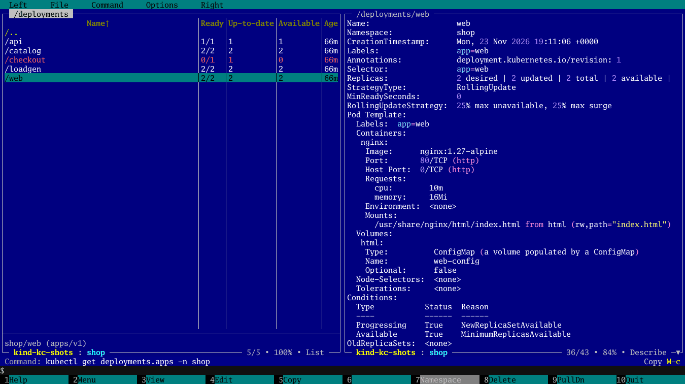

The Manifest panel mode. `F9`, Right, Manifest (`m`).

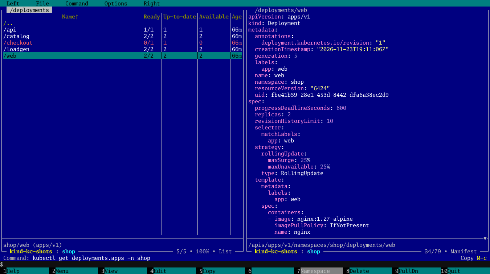

The Logs panel mode: the log of the pod under the cursor. `F9`, Right, Logs (`g`).

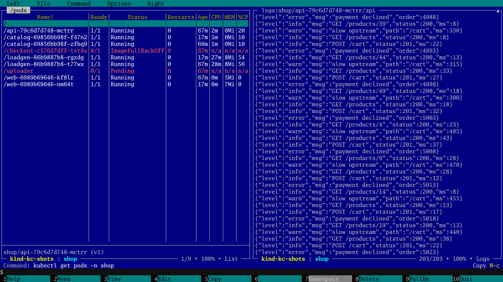

Merged logs of all pods of a Deployment, JSON lines formatted. `F3` on the `logs` row of a Deployment.

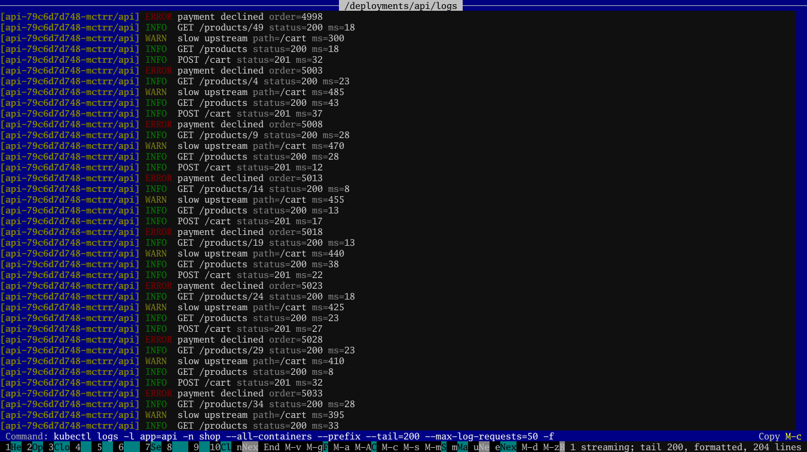

The log filter dialog. `M-g` in the logs viewer.

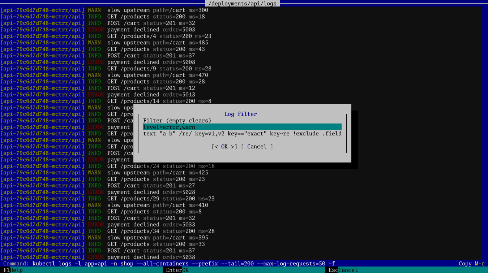

The filtered log: only lines with `level` error or warn (`level=error,warn`).

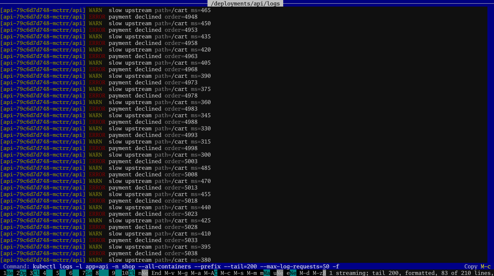

The fields of the JSON line under the cursor, to include or exclude by value. `M-d` in the logs viewer.

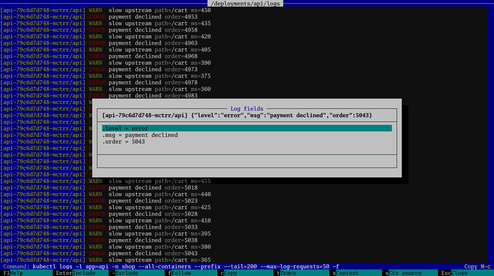

Local files in the other panel. `M-l`.

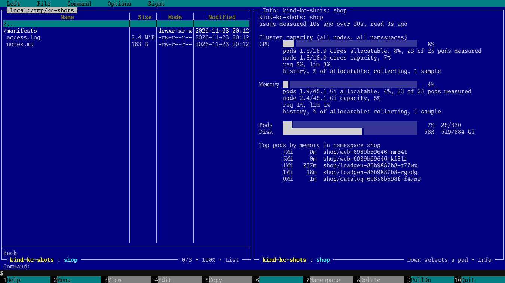

A local Markdown file in the viewer. `F3` on a local file.

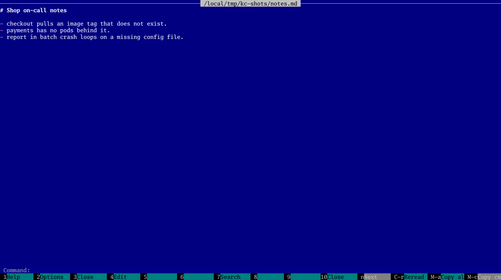

A large local file in the paged viewer, at its end. `F3` on a large file, then `End`.

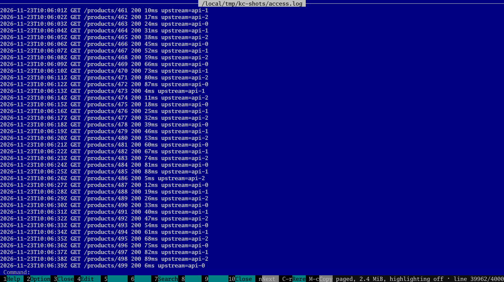

`F4` on a local file opens `$EDITOR` (vi here) in the terminal.

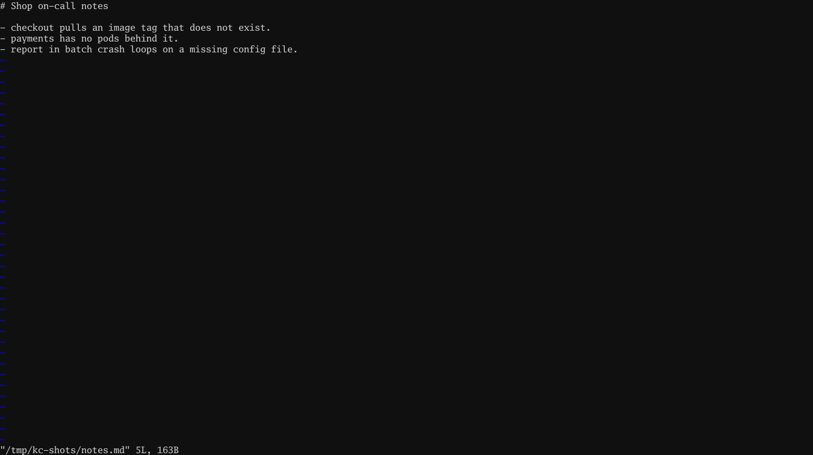

The copy dialog. `F5` on a row.

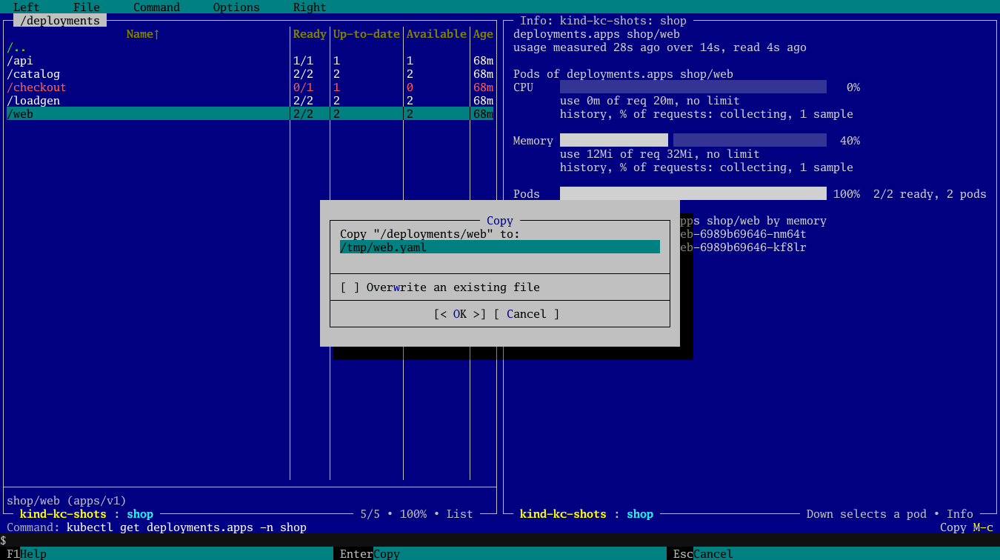
